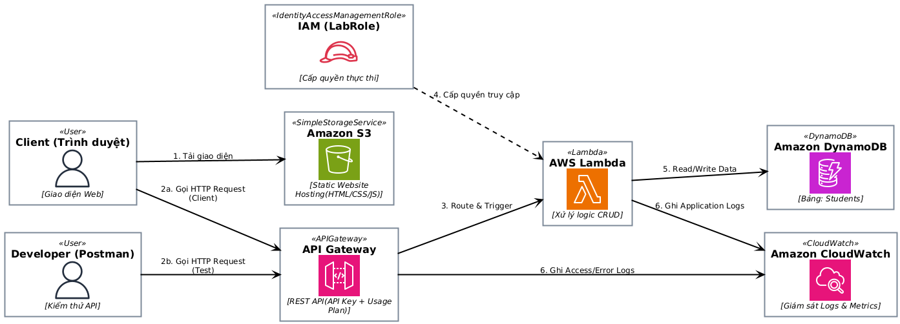
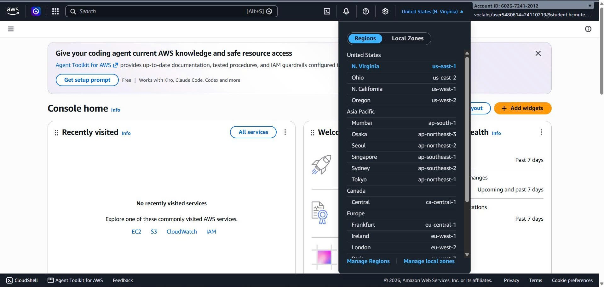
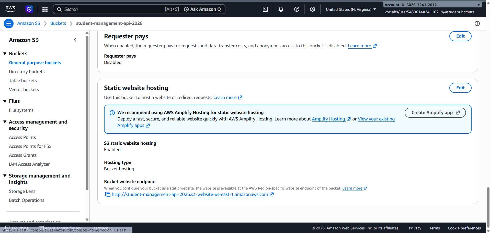
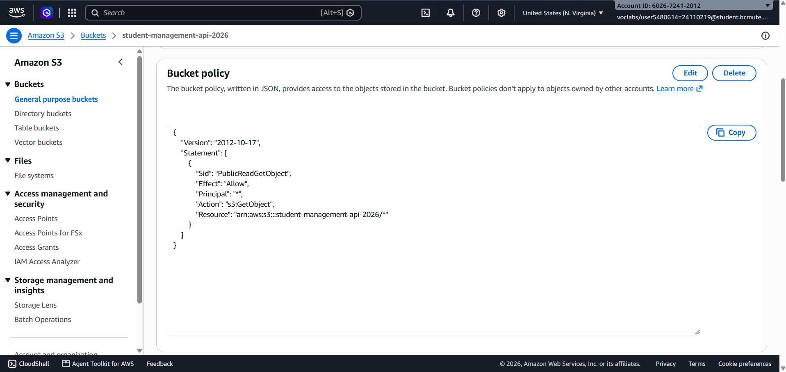
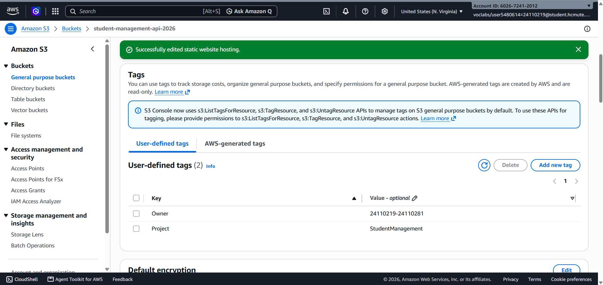
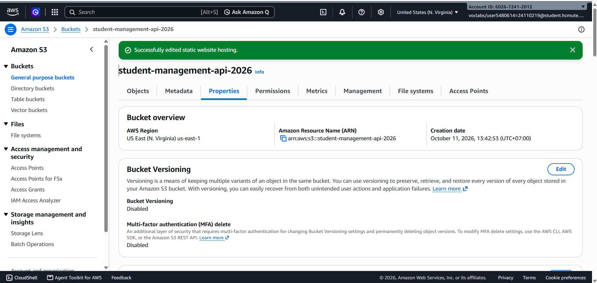
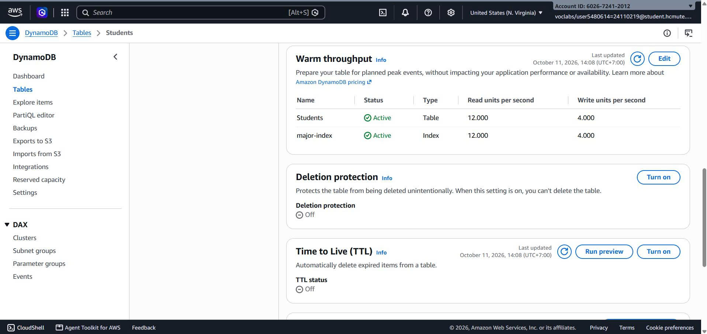
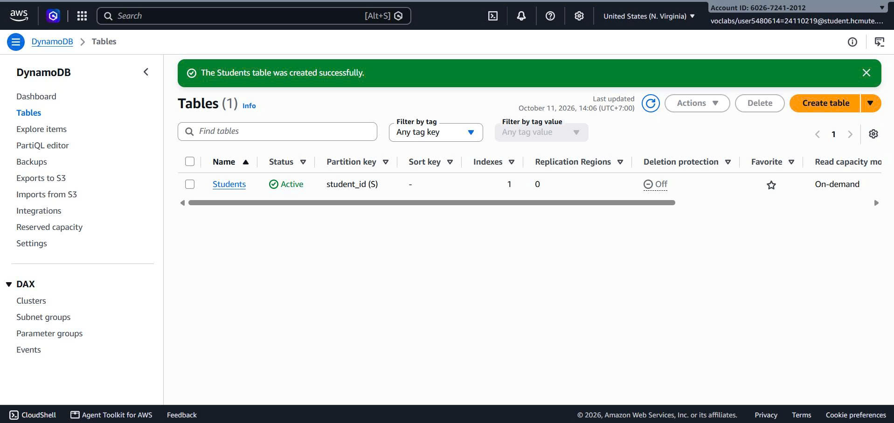

# 1. Mục tiêu tuần 1

Mục tiêu của tuần đầu tiên trong dự án là tìm hiểu các dịch vụ AWS cần được sử dụng trong đề tài “REST API quản lý sinh viên với API Gateway, Lambda và DynamoDB”, thiết kế và xây dựng sơ đồ hoạt động của hệ thống, tìm hiểu và chuẩn bị môi trường AWS Learner Lab. Cụ thể như sau:

- Nghiên cứu và nắm vững các dịch vụ lõi của AWS trong kiến trúc Serverless (S3, API Gateway, Lambda, DynamoDB).
- Đọc hiểu sổ tay Student Guide của AWS Academy Learner Lab để nắm rõ các giới hạn tài nguyên.
- Hoàn thiện bản vẽ thiết kế kiến trúc hệ thống và cấu trúc cơ sở dữ liệu NoSQL.
- Khởi tạo thành công các nền tảng hạ tầng ban đầu (S3 Bucket và bảng DynamoDB) trên AWS Console.
- Gắn tag cho các tài nguyên có hỗ trợ để dễ quản lý và nhận biết.

# 2. Nội dung công việc

## 2.1. Tìm hiểu các dịch vụ AWS

Khác với các hệ thống truyền thống đòi hỏi việc duy trì máy chủ ảo, dự án này áp dụng triệt để mô hình điện toán không máy chủ (Serverless). Nhóm đã nghiên cứu và quyết định sử dụng tổ hợp 4 dịch vụ cốt lõi:

- **Amazon S3**: Dùng để lưu trữ các tệp giao diện website tĩnh, giúp loại bỏ hoàn toàn việc phải thuê web server chuyên dụng.
- **AWS Lambda**: Thực thi logic mã nguồn backend (CRUD) theo cơ chế tính tiền trên mỗi mili-giây hoạt động.
- **Amazon API Gateway**: Cửa ngõ quản lý yêu cầu tiếp nhận từ website và chuyển đến Lambda xử lý, thiết lập bảo mật API Key và Rate Limit.
- **Amazon DynamoDB**: Cơ sở dữ liệu NoSQL lưu trữ thông tin sinh viên, có khả năng phản hồi tốc độ cao và hỗ trợ chế độ tính phí theo từng lượt truy vấn (On-demand).

Ngoài ra, nhóm tìm hiểu thêm về Amazon CloudWatch, là dịch vụ giúp thu thập nhật ký hoạt động từ Lambda và giám sát các chỉ số của API Gateway để dễ dàng phát hiện lỗi hệ thống. Nhóm cũng tìm hiểu cách sử dụng AWS IAM (cụ thể là LabRole) để thiết lập cơ chế phân quyền kiểm soát truy cập nghiêm ngặt, cho phép Lambda tương tác với DynamoDB một cách an toàn. Qua quá trình tìm hiểu, nhóm xác định được vai trò của từng dịch vụ và cách kết hợp chặt chẽ chúng để xây dựng một kiến trúc Serverless hoàn chỉnh, bảo mật và tối ưu chi phí.

## 2.2. Thiết kế và vẽ sơ đồ kiến trúc hệ thống

Sau khi tìm hiểu các dịch vụ, nhóm tiến hành xác định các thành phần chính của hệ thống quản lý sinh viên.

Hệ thống dự kiến xoay quanh việc lưu trữ và xử lý hồ sơ sinh viên. Người dùng sẽ thao tác với dữ liệu thông qua giao diện website được lưu trữ tĩnh trên Amazon S3.

Khi người dùng thực hiện các thao tác thêm, đọc, sửa, xóa (CRUD) trên website, yêu cầu HTTP sẽ được gửi đến API Gateway. Tại đây, hệ thống tiến hành kiểm tra bảo mật (API Key) và giới hạn lưu lượng trước khi chuyển yêu cầu đến AWS Lambda xử lý. Lambda sẽ thực thi các logic nghiệp vụ và tương tác trực tiếp với bảng DynamoDB (sử dụng khóa chính và chỉ mục phụ GSI) để cập nhật hoặc truy xuất dữ liệu.

Bên cạnh đó, Amazon CloudWatch sẽ được sử dụng để tự động thu thập nhật ký hoạt động của Lambda và giám sát các chỉ số lỗi từ API Gateway nhằm theo dõi sức khỏe của toàn bộ hệ thống.

**Sơ đồ kiến trúc hệ thống:** Dựa trên kiến trúc trên, nhóm tiến hành xây dựng sơ đồ tổng thể thể hiện luồng đi của dữ liệu và mối quan hệ giữa các thành phần trong hệ thống. Gồm các thành phần chính:

- Website giao diện người dùng được lưu trữ trên Amazon S3.
- API Gateway tiếp nhận, xác thực và định tuyến yêu cầu từ website hoặc công cụ kiểm thử.
- AWS Lambda (được cấp quyền bởi IAM LabRole) xử lý logic nghiệp vụ CRUD.
- Amazon DynamoDB (chế độ On-demand) lưu trữ thông tin sinh viên và truy vấn theo ngành học (GSI).
- Amazon CloudWatch theo dõi nhật ký hoạt động, giám sát số lượng yêu cầu và các mã lỗi.
- Công cụ Postman hỗ trợ nhà phát triển kiểm thử độc lập các endpoint.  

  <figure>
    
    <figcaption style="font-style: italic; color: gray;">
      Hình 1. Sơ đồ kiến trúc hệ thống quản lý sinh viên.
    </figcaption>
  </figure>

## 2.3. Chuẩn bị môi trường AWS Learner Lab

Nhóm chuẩn bị môi trường triển khai trên nền tảng AWS Learner Lab theo đúng yêu cầu và các giới hạn của môn học. Các công việc đã thực hiện gồm:

- Khởi động phiên làm việc và truy cập vào giao diện AWS Management Console.
- Thiết lập Region thống nhất là us-east-1 (N. Virginia) cho toàn bộ tài nguyên để tránh lỗi không đồng bộ dịch vụ.
- Tra cứu trong dịch vụ IAM và lưu trữ ARN của LabRole – đây là quyền duy nhất được cấp sẵn để chuẩn bị gắn cho AWS Lambda ở tuần tiếp theo.
- Nắm rõ giới hạn ngân sách và các quy định cấm (như không dùng Cognito, không tạo IAM Role mới) để đưa ra chiến lược tối ưu chi phí.

Trong quá trình thực hiện, nhóm tuân thủ nghiêm ngặt các quy định về quản lý tài nguyên của Learner Lab. Các dịch vụ được giới hạn chặt chẽ trong Region us-east-1, sử dụng đúng quyền phân cấp và luôn thực hiện thao tác đóng phiên sau mỗi buổi làm việc để tránh phát sinh chi phí ngoài ý muốn.

  <figure>
    
    <figcaption style="font-style: italic; color: gray;">
      Hình 2. Giao diện AWS Management Console và Region triển khai
    </figcaption>
  </figure>

## 2.4. Chuẩn bị Amazon S3

Để lưu trữ và phân phối giao diện web tĩnh của người dùng, nhóm tiến hành khởi tạo một S3 Bucket mang tên `student-management-api-2026`. Để bucket này có thể hoạt động như một máy chủ web thực thụ, nhóm đã thực hiện các cấu hình sau:

- Kích hoạt tính năng Static Website Hosting và chỉ định tệp giao diện mặc định là `index.html`.

  <figure>
    
    <figcaption style="font-style: italic; color: gray;">
      Hình 3. Kích hoạt tính năng Static Website Hosting
    </figcaption>
  </figure>

- Tắt tùy chọn “Block all public access” nhằm cho phép lưu lượng truy cập từ bên ngoài Internet và thiết lập Bucket Policy (định dạng JSON) sử dụng quyền `s3:GetObject`, cho phép tất cả người dùng công cộng có quyền tải và xem giao diện trang web.

  <figure>
    
    <figcaption style="font-style: italic; color: gray;">
      Hình 4. Thiết lập Bucket Policy
    </figcaption>
  </figure>

- Gắn các thẻ tag gồm Project và Owner để định danh và quản lý tài nguyên theo yêu cầu môn học.

| Tag | Giá trị | Mục đích |
| :--- | :--- | :--- |
| Project | StudentManagement | Xác định tài nguyên thuộc đề tài |
| Owner | 24110219-24110281 | Xác định nhóm phụ trách |

  <figure>
    
    <figcaption style="font-style: italic; color: gray;">
      Hình 5. Gắn tags
    </figcaption>
  </figure>

Sau khi hoàn tất, S3 cung cấp một URL Endpoint công khai, sẵn sàng để người dùng truy cập vào giao diện hệ thống quản lý sinh viên.

  <figure>
    
    <figcaption style="font-style: italic; color: gray;">
      Hình 6. Kết quả tạo Bucket Amazon S3
    </figcaption>
  </figure>

## 2.5. Chuẩn bị Amazon DynamoDB

Cơ sở dữ liệu của hệ thống được xây dựng bằng Amazon DynamoDB. Nhóm khởi tạo bảng dữ liệu NoSQL mang tên `Students` với các thiết lập tối ưu cho mô hình Serverless và giới hạn của Learner Lab.

- **Khóa phân vùng (Partition Key):** Cấu hình thuộc tính `student_id` (kiểu String) làm khóa chính nhằm định danh duy nhất mỗi hồ sơ sinh viên.
- **Chế độ dung lượng:** Quyết định chọn chế độ On-demand để bảo vệ ngân sách môn học. Ở chế độ này, hệ thống sẽ tự động co giãn và chỉ tính phí dựa trên số lượng request đọc/ghi thực tế thay vì tính phí dự phòng liên tục.
- **Chỉ mục phụ toàn cục (GSI):** Khởi tạo một GSI mang tên `major-index` với khóa phân vùng là `major` (kiểu String). GSI này giúp API có thể truy vấn và lọc danh sách sinh viên theo ngành học, tránh được thao tác quét toàn bảng gây chậm và tốn kém chi phí.

  <figure>
    
    <figcaption style="font-style: italic; color: gray;">
      Hình 7. GSI major-index
    </figcaption>
  </figure>

- Tương tự như S3, bảng DynamoDB cũng được đánh dấu bằng các thẻ Tag (`Project: StudentManagement`, `Owner: 24110219-24110281`) để hỗ trợ việc phân bổ và báo cáo chi phí cuối kỳ.

  <figure>
    
    <figcaption style="font-style: italic; color: gray;">
      Hình 8. Bảng Students được khởi tạo với chế độ On-demand
    </figcaption>
  </figure>

Sau bước này, cơ sở dữ liệu đã ở trạng thái Active và hoàn toàn sẵn sàng tiếp nhận dữ liệu từ các hàm Lambda.

**Cấu trúc bảng Students nhóm dự định cài đặt:**

| Tên thuộc tính | Kiểu dữ liệu | Ý nghĩa |
| :--- | :--- | :--- |
| student_id | String (S) | Mã sinh viên, dùng làm khóa phân vùng (Partition Key - PK) |
| major | String (S) | Chuyên ngành, có tạo khóa phân vùng GSI (GSI Partition Key) |
| full_name | String (S) | Họ và tên đầy đủ của sinh viên |
| email | String (S) | Địa chỉ email liên hệ của sinh viên |
| gpa | Number (N) | Điểm trung bình tích lũy |
| birth_day | String (S) | Ngày sinh của sinh viên |
| is_active | Boolean (BOOL) | Trạng thái hiện tại (đang học hoặc nghỉ/ bảo lưu) |
| created_at | String (S) | Thời điểm tạo hồ sơ |
| updated_at | String (S) | Thời điểm gần nhất cập nhật hồ sơ |

# 3. Kết quả công việc tuần 1

- Tìm hiểu về đề tài và các dịch vụ sử dụng trong đề tài.
- Sơ đồ kiến trúc và thiết kế CSDL (Khóa chính, GSI) đã được chốt.
- Môi trường lưu trữ Web (S3) và Database (DynamoDB) đã Active trên Region us-east-1 và sẵn sàng kết nối.
- Đảm bảo không phát sinh chi phí lãng phí trong Lab nhờ dùng On-demand và đã End Lab an toàn.